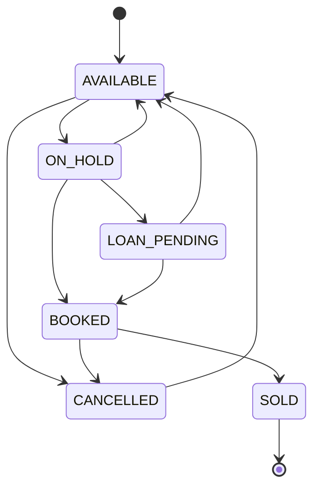

# Plot Lifecycle Platform

A web application for real-estate sales teams that sell plots. It tracks inventory through a strict
sales lifecycle, turns leads into buyers, records payments and installments, calculates agent
commissions, and keeps an audit trail. Managers get a live dashboard and a REST API.

**Stack:** Java 17 · Spring Boot 3.3 (Web, Data JPA, Security, Validation, Thymeleaf, Actuator) · SQLite ·
Bootstrap 5 · Chart.js · Maven · Docker

## Features

| Area | What it does |
|---|---|
| **Projects & inventory** | Create projects and plots (block, area, facing, price). Plots move through a lifecycle state machine; illegal jumps are rejected on the server. |
| **Leads & buyers** | Capture leads with source and assigned agent, then convert a lead to a buyer against a specific plot with an ID proof and a payment plan (full payment, installment or loan). |
| **Payments** | Record down payments, installments, loan disbursements and refunds. Each payment type can move the plot to its next status. |
| **Installments** | The installment plan splits 80% of the price into six monthly tranches. Payments are reconciled against the earliest unpaid tranche, and an overdue scanner flags late ones. |
| **Commissions** | A 2% commission is computed when a plot becomes `SOLD`, credited to the lead's assigned agent, with an agent leaderboard. |
| **Audit log** | Every important action is recorded with the user and a timestamp (admin only). |
| **Dashboard** | Cards, charts and tables fed by one JSON endpoint, filterable by project, refreshing every 30 seconds, plus a rule-based executive briefing. |
| **REST API** | `/api/v1/...` with HTTP Basic auth, JSON bodies and consistent JSON errors. |
| **Access control** | Database-backed users with BCrypt hashes and three roles (admin, agent, accountant). |

## Quick start

You need Java 17 and Maven, or just Docker.

```bash
mvn clean spring-boot:run
```

Open http://localhost:8080 and sign in with a demo account:

| Username | Password | Role |
|---|---|---|
| `admin` | `admin123` | Everything, including the audit log |
| `agent` | `agent123` | Projects, inventory, leads, commissions |
| `accountant` | `accountant123` | Inventory, payments, installments, commissions |

On first start the app creates the SQLite file `realestate-prototype.db` and seeds two projects, 16 plots, two
demo sales (one installment plan, one full payment) and two open leads. These passwords are for local use only;
see [DEPLOYMENT.md](DEPLOYMENT.md) before putting the app online.

With Docker:

```bash
cp .env.example .env        # then set the three SEED_*_PASSWORD values
docker compose up --build   # http://localhost:8080
```

For a guided walkthrough of every feature, see [docs/DEMO.md](docs/DEMO.md).

## How it works

### Plot lifecycle



The allowed transitions live in one table in `SiteLifecycleService`. `SOLD` is terminal: a sold plot is locked.

### What moves a plot

| Event | Effect |
|---|---|
| Convert a lead to a buyer | Plot goes `AVAILABLE → ON_HOLD`; an installment plan also generates the six tranches |
| Down payment (installment or full-payment plan) | `ON_HOLD → BOOKED` |
| Down payment (loan plan) | `ON_HOLD → LOAN_PENDING`, then `BOOKED` when the loan is disbursed |
| Installment payments that bring the total paid to the plot price | `BOOKED → SOLD` |
| Refund | `→ CANCELLED` |
| Plot reaches `SOLD` | 2% commission is created for the lead's agent |

A plot can also be moved manually from the inventory page, but only along the allowed transitions.

### Money handling

All amounts are `BigDecimal` with explicit rounding. The six tranches use the base amount for tranches 1 to 5, and
the sixth takes the remainder, so the schedule always adds up exactly to 80% of the price.

## Roles

| Area | Admin | Agent | Accountant |
|---|:-:|:-:|:-:|
| Dashboard | ✓ | ✓ | ✓ |
| Projects | ✓ | ✓ | |
| Inventory (plots) | ✓ | ✓ | ✓ |
| Leads and conversion | ✓ | ✓ | |
| Payments (Ledger) and installments | ✓ | | ✓ |
| Commissions | ✓ | ✓ | ✓ |
| Audit log | ✓ | | |

Anyone can self-register at `/register`, but only as an agent or an accountant. Admin accounts are created only by
the seeder. Registration can be switched off completely with `ALLOW_REGISTRATION=false`.

## REST API

Endpoints live under `/api/v1/` and use HTTP Basic auth and JSON. Role rules match the web pages.

```bash
curl -u admin:admin123 http://localhost:8080/api/v1/sites?status=AVAILABLE
```

Errors return `{"error": "..."}` with `400` for bad input, `404` not found, `409` when a business rule is violated,
and `401`/`403` for authentication and permission failures.

| Method | Endpoint | Description |
|---|---|---|
| GET | `/api/v1/projects` | List projects |
| POST | `/api/v1/projects` | `{ "name": "...", "location": "..." }` |
| GET | `/api/v1/sites` | List plots (`?status=AVAILABLE`) |
| POST | `/api/v1/sites` | `{ "projectId": 1, "block": "A", "areaSqft": 1200, "facing": "East", "price": 1500000 }` |
| POST | `/api/v1/sites/{id}/transition` | `{ "target": "BOOKED" }` |
| DELETE | `/api/v1/sites/{id}` | Delete a plot (only if `AVAILABLE` or `CANCELLED`) |
| GET | `/api/v1/leads` | List leads |
| POST | `/api/v1/leads` | `{ "name": "...", "phone": "...", "source": "WEBSITE", "assignedAgent": "agent" }` |
| POST | `/api/v1/leads/{id}/convert` | `{ "siteId": 1, "idProofType": "Aadhaar", "idProofNumber": "...", "paymentPlan": "INSTALLMENT" }` |
| GET | `/api/v1/buyers` | List buyers |
| GET | `/api/v1/payments` | List the payment ledger |
| POST | `/api/v1/payments` | `{ "buyerId": 1, "amount": 300000, "paymentType": "DOWN_PAYMENT" }` |
| GET | `/api/v1/installments` | List schedules (`?buyerId=1`) |
| POST | `/api/v1/installments/check-overdue` | Run the overdue scanner |
| GET | `/api/v1/commissions` | List commissions |
| GET | `/api/v1/commissions/leaderboard` | Agent rankings |
| GET | `/api/v1/audit-logs` | Audit trail (admin only) |

Lead sources: `WEBSITE`, `REFERRAL`, `WALK_IN`, `SOCIAL_MEDIA`, `CAMPAIGN`, `PHONE_INQUIRY`. Payment plans:
`FULL_PAYMENT`, `INSTALLMENT`, `LOAN`. Payment types: `DOWN_PAYMENT`, `INSTALLMENT`, `LOAN_DISBURSEMENT`, `REFUND`.

The browser pages use form login with CSRF protection. CSRF is disabled only for `/api/v1/**`, which uses Basic auth
with no browser session.

## Dashboard

`GET /api/dashboard/summary?projectId=&days=` feeds the whole page. A project filter applies to every card,
chart and table. It shows:

- **Cards:** total units, sell-through %, sales value, unsold inventory value, collections, outstanding
  balance, refunds, lead conversion %, overdue tranches and projected receivables.
- **Charts:** inventory by status, revenue trend (7 / 30 / 90 days), lead pipeline, money by payment type.
- **Tables:** receivables watch, latest ledger entries, agent leaderboard, project comparison.
- **Plot matrix** colour-coded by status.
- **Executive briefing** (`GET /api/dashboard/ai-summary`): portfolio health, cash flow, collection risk and a
  priority, written by a deterministic rule-based engine. It calls no external service and needs no API key.

*Sales value* is the price of booked and sold plots. *Outstanding* is plot price minus money received for buyers
still holding a plot. *Revenue* excludes refunds, which are shown separately.

## Configuration

All settings come from environment variables, with safe local defaults.

| Variable | Purpose | Default |
|---|---|---|
| `PORT` | HTTP port | `8080` |
| `DB_PATH` | SQLite file location | `realestate-prototype.db` |
| `SEED_ADMIN_PASSWORD`, `SEED_AGENT_PASSWORD`, `SEED_ACCOUNTANT_PASSWORD` | Demo account passwords, used only when the database is first created | `admin123` / `agent123` / `accountant123` |
| `ALLOW_REGISTRATION` | Allow `/register` for agents and accountants | `true` |
| `SHOW_DEMO_CREDENTIALS` | Show the demo logins on the sign-in page | `false` |
| `COOKIE_SECURE` | Mark the session cookie as HTTPS-only | `false` |
| `THYMELEAF_CACHE` | Cache templates (set `false` while editing pages) | `true` |
| `SHOW_SQL` | Log SQL statements | `false` |

Health checks: `GET /actuator/health` and `GET /actuator/health/liveness` are public and expose no details.

## Deploying

See **[DEPLOYMENT.md](DEPLOYMENT.md)** for Docker, Docker Compose, hosted platforms, HTTPS, backups and
troubleshooting.

## Project structure

```
src/main/java/com/realestate/
  PlotLifecycleApplication.java   entry point
  config/        SecurityConfig (roles, Basic auth for the API), DataSeeder (demo data)
  controller/    web pages: Dashboard, Site, Project, Lead, Payment, Installment, Commission, Audit, Auth
  api/           REST API: ApiController, ApiRequests (JSON bodies), ApiExceptionHandler
  service/       business rules: SiteLifecycle, Lead, Payment, InstallmentSchedule, Commission,
                 Dashboard, Ai (briefing), Audit, User
  repository/    one Spring Data interface per table
  model/         JPA entities and enums
  dto/           form objects with validation
src/main/resources/
  application.properties   all configuration
  static/css/              site theme
  templates/               Thymeleaf pages (fragments/nav.html is the shared menu)
```

## Known limitations

- **SQLite is a single file**, so run one instance and keep the database on a persistent disk. For several
  instances or heavy write load, move to PostgreSQL or MySQL.
- **Schema changes use `ddl-auto=update`.** That is fine for a prototype, but a production system should use
  migrations such as Flyway.
- **Business rules are fixed in code:** the 20% down payment, six monthly tranches and 2% commission. Making them
  configurable per project is a natural next step.
- **Bootstrap and Chart.js load from a CDN**, so the pages need internet access in the browser.
- **There is no automated test suite yet.** Good first tests: the lifecycle transition table, the tranche
  split and the payment-to-status rules.

## Continuous integration

`.github/workflows/ci.yml` runs `mvn -B verify` on every push and pull request.
